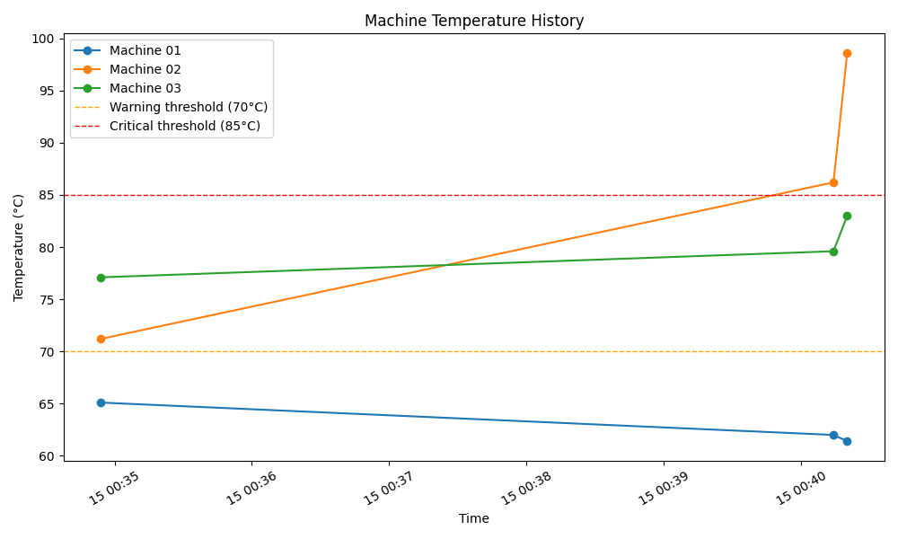

# Smart Temperature Monitor

A Python-based **simulated** temperature monitoring system that generates sensor readings for multiple machines, classifies them by severity, logs them to CSV, and visualizes temperature trends over time.

> \\\*\\\*Note:\\\*\\\* This is a simulation/portfolio project. It does not connect to any real hardware or industrial equipment — all temperature readings are generated programmatically to model realistic sensor behavior.

\---

## Project Purpose

I built this project to practice and demonstrate core software engineering skills that are directly relevant to industrial monitoring and IoT-adjacent software roles: reading structured sensor-style data, applying threshold-based logic to detect anomalies, persisting data, and visualizing results. It's intentionally kept small and readable rather than over-engineered, so the design decisions are easy to explain and defend.

## Features

* Simulates temperature readings for multiple machines (Machine 01, 02, 03 — easily extendable)
* Classifies each reading as **NORMAL**, **WARNING**, or **CRITICAL** based on configurable thresholds
* Clearly reports abnormal (WARNING/CRITICAL) readings as alerts
* Displays machine name, temperature, timestamp, and status for each reading
* Appends every reading to a CSV file for historical record-keeping
* Generates a Matplotlib line graph of temperature history, with threshold reference lines
* Lets the user run multiple monitoring cycles in one session
* Includes basic error handling around file I/O and graph generation

## Technologies Used

* **Python 3**
* **Pandas** — reading and organizing CSV data for plotting
* **Matplotlib** — generating the temperature history graph
* **csv** (standard library) — writing sensor readings to disk
* **datetime** (standard library) — timestamping readings
* **random** (standard library) — simulating sensor values

## Project Structure

```
Smart-Temperature-Monitor/
├── main.py                # Entry point - runs the monitoring loop
├── sensor\\\_simulator.py    # Generates simulated temperature readings
├── analyzer.py            # Classifies readings and saves them to CSV
├── visualizer.py          # Generates the temperature history graph
├── data/
│   └── sensor\\\_data.csv    # Created automatically on first run
├── requirements.txt       # Python dependencies
├── README.md
└── .gitignore
```

## Installation

1. Clone the repository:

```bash
   git clone https://github.com/IsratJahanAnny/Smart-Temperature-Monitor.git
   cd Smart-Temperature-Monitor
   ```

2. (Optional but recommended) create a virtual environment:

```bash
   python3 -m venv venv
   source venv/bin/activate   # On Windows: venv\\\\Scripts\\\\activate
   ```

3. Install dependencies:

```bash
   pip install -r requirements.txt
   ```

## How to Run

```bash
python main.py
```

You'll be shown a monitoring cycle for all machines, and then be asked whether you'd like to run another cycle. Each cycle appends new readings to `data/sensor\\\_data.csv` and regenerates `data/temperature\\\_graph.png` from the full history.

## Example Output

```
====================================
   SMART TEMPERATURE MONITOR
====================================
Machine 01
Temperature: 67.4°C
Status: NORMAL

Machine 02
Temperature: 78.2°C
Status: WARNING

Machine 03
Temperature: 91.6°C
Status: CRITICAL

!!! ALERT: Abnormal temperature(s) detected !!!
 - Machine 02 is WARNING at 78.2°C
 - Machine 03 is CRITICAL at 91.6°C

Sensor readings saved to:
data/sensor\\\_data.csv
Temperature graph generated successfully.

Run another monitoring cycle? (y/n):
```
## Temperature Monitoring Graph


### Temperature Thresholds

|Status|Range|
|-|-|
|NORMAL|below 70°C|
|WARNING|70°C – 84.9°C|
|CRITICAL|85°C and above|

## What This Project Demonstrates

* **Python programming** — functions, dictionaries, loops, and modular file organization
* **Data processing** — structuring and classifying sensor readings
* **Sensor simulation** — modeling realistic sensor behavior without physical hardware
* **Threshold-based anomaly detection** — a simplified version of logic used in real industrial monitoring systems
* **CSV data storage** — persisting time-series data to disk
* **Data visualization** — using Matplotlib and Pandas to turn raw data into an interpretable chart

## Future Improvements

* Add unit tests (e.g. with `pytest`) for the classification and CSV logic
* Support configuring machines and thresholds via a config file (JSON/YAML)
* Add a simple web dashboard (e.g. Flask or Streamlit) instead of a console interface
* Support exporting an "alert log" of only abnormal readings
* Add logging (via Python's `logging` module) instead of print statements
* Package as an installable CLI tool

## \## Author

\*\*Israt Jahan Anny\*\*

Computer Science Graduate Student

GitHub: https://github.com/IsratJahanAnny

Email: isaj8334@gmail.com

\---

